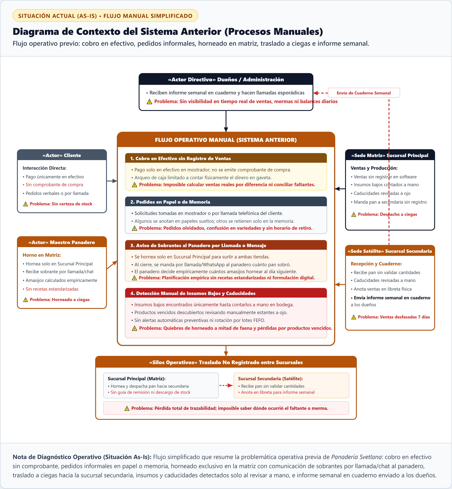

# Especificación del Diagrama de Contexto del Sistema Anterior (Situación As-Is)

> **Documento Académico y Técnico para Memoria de Tesis / Proyecto de Graduación**  
> **Tema:** Diagnóstico y Exposición del Flujo Operativo Tradicional Previo a la Automatización — *Panadería Svetlana*  
> **Estándar de Modelado:** Diagrama de Contexto del Sistema Tradicional (As-Is / Flujo Manual Simplificado)  
> **Formato de Citas y Figuras:** Normas APA 7.ª edición  

---

## 1. Definición del Contexto Operativo Previo (Diagnóstico As-Is)

El **Diagrama de Contexto del Sistema Anterior (Modelo As-Is)** sintetiza visualmente la realidad operativa que regía en *Panadería Svetlana* con anterioridad al desarrollo de la solución informática.

Para facilitar su exposición técnica ante el comité evaluador y agilizar su comprensión en la memoria de tesis, este modelo adopta un **enfoque simplificado y directo**: en lugar de extensos párrafos teóricos, cada nodo expone con precisión el **problema operativo concreto** sin elementos ajenos al alcance del sistema desarrollado.

El diagrama delimita cómo operaban las dos sedes: cobro en efectivo sin registro ni comprobante, pedidos informales (papel o memoria), horneado centralizado en la matriz con aviso informal de sobrantes al panadero por llamada o WhatsApp, traslado de pan a ciegas hacia la sucursal secundaria, control empírico de insumos y caducidades, y supervisión retardada mediante un informe semanal manuscrito en cuaderno para los dueños.

---

## 2. Representación Gráfica del Proceso Anterior (Normas APA 7)

A continuación se presenta la figura técnica en formato limpio y sintetizado para inserción en la tesis o diapositivas de defensa:

#### **Figura 2**  
*Diagrama de Contexto del Sistema Anterior: Flujos Operativos y Problemática Manual en Panadería Svetlana*

> **Nota.** El diagrama ilustra el flujo operativo tradicional (*As-Is*) simplificado de *Panadería Svetlana* previo a la implementación del sistema web. Se exponen los puntos críticos de dolor identificados: cobro exclusivo en efectivo en mostrador sin registro de transacciones ni emisión de comprobante; pedidos de palabra o en papel suelto; horneado centralizado en la Sucursal Principal con comunicación nocturna de sobrantes al panadero por llamada/WhatsApp para calcular la producción del día siguiente de forma empírica; traslado de pan hacia la Sucursal Secundaria sin control de salida ni entrada de stock; detección manual tardía de materias primas agotadas y caducidades en estante; y rendición de cuentas a los dueños mediante un informe semanal manuscrito en cuaderno con 7 días de retraso. Elaboración propia (2026).

---

## 3. Matriz Sintética de Diagnóstico (Problema por Nodo)

Para su exposición oral en la defensa de tesis, cada nodo del diagrama se defiende con base en el problema operativo que justificó la solución digital:

#### **Tabla 2**  
*Resumen de Nodos y Problemática Operativa del Sistema Tradicional*

| Nodo / Actor del Diagrama | Acción / Flujo Manual | Problema Crítico Identificado | Solución Implementada en el Nuevo Sistema |
|---|---|---|---|
| **Dueños / Administración** | Reciben informe semanal en cuaderno y realizan llamadas esporádicas a la matriz. | **Supervisión desfasada:** Cero visibilidad en tiempo real de ventas diarias, ganancias netas o mermas. | **Panel Operación en Tiempo Real + Bot de Telegram** para consultas instantáneas de ventas e inventario. |
| **Cliente** | Compra presencial en mostrador; pedidos por llamada telefónica o visita verbal. | **Incertidumbre de stock:** Pago solo en efectivo sin comprobante; pedidos de palabra que no se reclaman. | **Tienda Web con Carrito y Reserva:** Catálogo online con selección de sucursal y franja de retiro. |
| **Maestro Panadero** | Hornea solo en matriz; recibe el sobrante del día anterior por llamada o mensaje de WhatsApp. | **Horneado a ciegas:** Dosifica ingredientes de forma empírica; desconoce quiebres de insumos con anticipación. | **Módulo de Recetas por Amasijo y Latas:** Cálculo exacto de formulación y producción transaccional ACID. |
| **Sucursal Principal (Matriz)** | Vende en mostrador sin registrar; hornea para ambas tiendas; despacha pan a secundaria. | **Despacho a ciegas:** Sin registro de salida; insumos agotados y caducidades revisadas solo a mano. | **Control de Stock y Cierre Diario:** Venta residual automática y alertas de stock crítico de materia prima. |
| **Sucursal Secundaria** | Recibe pan de la matriz; vende sin software; elabora informe semanal en cuaderno físico. | **Información desfasada 7 días:** Recibe pan sin validar cantidades y caducidades detectadas a mano. | **Aislamiento Multi-Sucursal (`BranchScopeGuard`):** Inventario por sucursal con trazabilidad de stock. |
| **Traslado entre Sucursales** | Envío físico diario de canastas/latas de pan horneado de matriz a secundaria. | **Pérdida total de trazabilidad:** Si falta pan o hay merma, es imposible saber en cuál sucursal ocurrió. | **Gestión Centralizada de Inventario:** Control de existencias diferenciadas por sede física. |

---

## 4. Comparativa Directa: Flujo Manual vs. Módulos del Sistema Desarrollado

#### **Tabla 3**  
*Mapeo de Transformación: Diagnóstico As-Is vs. Módulos To-Be*

| Punto Operativo | Situación Manual Anterior (As-Is) | Solución Automatizada (To-Be) | Módulo del Sistema |
|---|---|---|---|
| **Ventas en Mostrador** | Efectivo sin comprobante ni registro; arqueo contando gaveta. | Venta por diferencia residual: $\text{Venta} = \text{Inicial} + \text{Producción} - \text{Final} - \text{Merma}$. | `DailyCloseService` (Cierre Diario) |
| **Toma de Pedidos** | Anotados en papel o retenidos de memoria; alta tasa de olvidos. | Carrito de compras web y reserva para retiro en tienda con franja horaria. | `OrdersModule` (Reservas B2C) |
| **Aviso al Panadero** | Llamada/WhatsApp nocturno informando el sobrante; cálculo empírico. | Recetas por amasijo y latas con descuento atómico de materia prima. | `ProductionModule` (Producción ACID) |
| **Insumos y Caducidad** | Insumos agotados y caducidades detectados solo al revisar a mano. | Inventario de materia prima con alertas mínimas y lotes con método FEFO. | `RawMaterial` & `InventoryLot` |
| **Traslado a Secundaria** | Pan horneado en matriz y enviado a secundaria sin registro alguno. | Inventario separado por sucursal con control de acceso por roles (RBAC). | `BranchScopeGuard` (Multi-Sucursal) |
| **Reportes para Dueños** | Cuaderno semanal manuscrito llevado físicamente a los dueños. | Panel gerencial con KPIs en tiempo real y asistente privado en Telegram. | Panel Operación + Telegram Bot |
